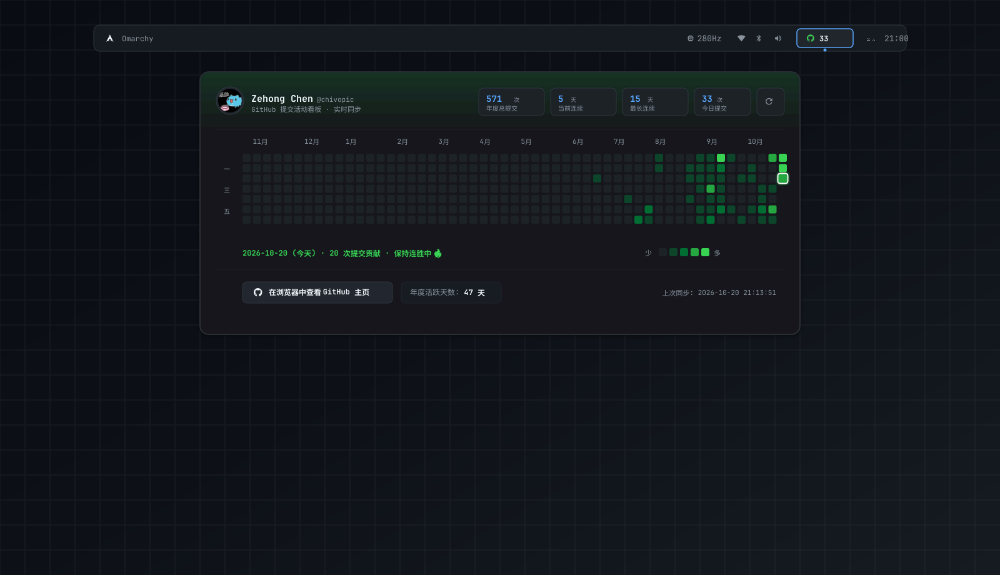

# Omarchy GitHub Commit Heatmap

<p align="center">
  
</p>

<p align="center">
  <a href="https://plugins.omarchy.org"></a>
  <a href="LICENSE"></a>
  
</p>

<p align="center">
  <b>English</b> · <a href="README_zh.md">简体中文</a>
</p>

A native [Quickshell](https://quickshell.org/) bar widget for [Omarchy](https://omarchy.org/) Linux that lets you click anytime to inspect your GitHub commit heatmap, streak statistics, and contribution history.

---

## ✨ Features

- 🟩 **Full 53-Week Contribution Matrix**: Displays a complete year of daily commit activity with adaptive month and weekday alignment.
- 📊 **Key Metrics & Streak Badges**:
  - Total contributions over the past year
  - Current consecutive streak (days)
  - Longest streak record (days)
  - Today's commits
  - Active contribution days
- 🖱️ **Interactive Hover & Live Details**:
  - Hovering over any cell previews its exact date, weekday, and commit count.
  - Interactive cell scaling and focus border animation.
- 🔄 **Resilient Dual-Mode Data Engine**:
  - Primary: Uses `gh api graphql` with your authenticated GitHub CLI token (supports private repo contributions).
  - Fallback: Gracefully falls back to public contribution endpoints and local cached data if unauthenticated or offline.
  - Instant zero-latency startup rendering with background refresh timer (15 minutes).
- 🎨 **Omarchy Theme Harmony**:
  - Supports classic GitHub green scale or theme-adaptive accent colors.
  - Built with native Omarchy styling (`BorderSurface`, `PopupCard`, Nerd Font glyphs).
- 🔌 **Full Shell IPC & Hotkey Support**:
  - Summon or toggle the popup panel anytime from your terminal or Hyprland keybindings.

---

## 🚀 Usage

| Action | Result |
| :--- | :--- |
| **Left-click bar widget** | Toggle the GitHub Heatmap popup card |
| **Middle-click bar widget** | Force background sync with GitHub and show a desktop notification |
| **Right-click bar widget** | Open your GitHub profile directly in default browser (`xdg-open`) |
| **Hover over heatmap cells** | Display detailed date and commit statistics in bottom status line |
| **Profile button in popup** | One-click jump to your full GitHub profile page |

---

## ⌨️ Hotkeys & Shell IPC

You can control the widget from terminal scripts or Hyprland keybindings via the Omarchy Shell IPC:

```bash
# Toggle the heatmap popup
omarchy-shell io.github.chivopic.github-heatmap toggle

# Open the panel
omarchy-shell io.github.chivopic.github-heatmap open

# Close the panel
omarchy-shell io.github.chivopic.github-heatmap close

# Trigger an immediate data sync
omarchy-shell io.github.chivopic.github-heatmap refresh
```

### Bind to a Hyprland Shortcut

Add a binding to `~/.config/hypr/bindings.lua` (e.g. `Super + Shift + G`):

```lua
-- Press Super + Shift + G to toggle the GitHub Heatmap anytime
o.bind("SUPER_SHIFT", "G", function()
  hl.exec("omarchy-shell io.github.chivopic.github-heatmap toggle")
end)
```

---

## 🛠️ Installation & Configuration

### 1. Install via Omarchy Plugin Marketplace

```bash
omarchy plugin add https://github.com/chivopic/omarchy-github-heatmap.git --enable
```

### 2. Manual Development Install

```bash
# Link to your Omarchy plugins directory
ln -s ~/Projects/omarchy-github-heatmap ~/.config/omarchy/plugins/io.github.chivopic.github-heatmap

# Rescan and enable
omarchy-shell shell rescanPlugins
omarchy plugin enable io.github.chivopic.github-heatmap right
```

### 3. User Account Configuration

The plugin automatically detects your GitHub username in the following priority order:
1. `username` field in `~/.config/omarchy-github-heatmap/config.json`
2. `gh api user -q .login` (logged-in GitHub CLI user)
3. `git config --get github.user`
4. Fallback default (`chivopic`)

To switch to another GitHub user:

```bash
python3 ~/Projects/omarchy-github-heatmap/backend.py set-user <your-github-username>
omarchy-shell io.github.chivopic.github-heatmap refresh
```

---

## ⚙️ Widget Settings

Configurable via `~/.config/omarchy/shell.json`:

| Key | Type | Default | Description |
| :--- | :--- | :--- | :--- |
| `showCount` | boolean | `true` | Show contribution number next to the Octocat icon on the bar |
| `countMode` | string | `"today"` | Number displayed on bar: `"today"` (today's commits) or `"total"` (yearly total) |
| `colorTheme` | string | `"github"` | Cell color scheme: `"github"` (classic green) or `"accent"` (system theme accent) |

---

## 📦 Dependencies

- **Python 3**: Used for backend data normalization and caching (standard library only; no extra pip packages required).
- **GitHub CLI (`gh`)** *(Optional, recommended)*: Enables authenticated GraphQL queries including authorized private contributions.
- **Nerd Font**: Pre-installed on Omarchy (for the Octocat glyph `󰊤`).

---

## 🗑️ Removal

To remove the plugin from Omarchy bar and system:

```bash
omarchy plugin remove io.github.chivopic.github-heatmap --yes
```

---

## 📄 License

Licensed under the [MIT](LICENSE) License.
